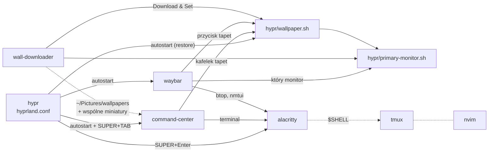

# linux-tools

Moje narzędzia i configi do **Hyprlanda** na Arch / CachyOS. Wszystko w jednym, czarno-białym, „terminalowym” stylu. Każdy element to osobne repo i można go wziąć sam albo razem z resztą. To repo zbiera je w jednym miejscu: pokazuje, co z czym współpracuje, i instaluje oraz aktualizuje wybrane jednym poleceniem.

| Repo | Co to jest | Gdzie trafia |
|---|---|---|
| [**hypr**](https://github.com/K-u-r-c/hypr) | config Hyprlanda + `wallpaper.sh` (tapety-obrazy przez hyprpaper, wideo przez mpvpaper) + skrypty od monitorów | `~/.config/hypr` |
| [**command-center**](https://github.com/K-u-r-c/command-center) | HUD pod SUPER+TAB: wyszukiwarka aplikacji, audio, jasność monitorów, Bluetooth, zrzuty, tapety, monitor systemu | `~/.local/share/command-center` |
| [**waybar**](https://github.com/K-u-r-c/waybar) | terminalowy pasek z auto-hide, tylko na głównym monitorze | `~/.config/waybar` |
| [**wall-downloader**](https://github.com/K-u-r-c/wall-downloader) | przeglądarka i pobieranie animowanych tapet z MoeWalls | `~/.local/share/wall-downloader` |
| [**alacritty**](https://github.com/K-u-r-c/alacritty) | terminal: czarny, przezroczysty | `~/.config/alacritty` |
| [**tmux**](https://github.com/K-u-r-c/tmux) | tmux bez stałego paska, który pojawia się z animacją po Ctrl+Space | `~/.config/tmux` |
| [**nvim**](https://github.com/K-u-r-c/nvim) | Neovim na LazyVim: LSP dla kilkunastu języków, DAP, testy, Godot | `~/.config/nvim` |

## Co z czym działa



- **hypr** spina całość: odpala waybar, tapety i demona command center.
- `wallpaper.sh` z **hypr** to jedyny kod, który ustawia tapety. command center, waybar i wall-downloader tylko go wołają.
- **command-center** i **wall-downloader** działają też bez reszty, tylko bez `wallpaper.sh` nie ustawiają tapet (command center je wyświetla, wall-downloader pobiera).
- **alacritty**, **tmux** i **nvim** są niezależne. Działają na każdym systemie, nie tylko z Hyprlandem.

## Instalacja

```bash
git clone https://github.com/K-u-r-c/linux-tools ~/linux-tools
cd ~/linux-tools

./install.sh                               # lista komponentów (✓ = zainstalowany)
./install.sh --deps command-center hypr    # pakiety (pacman + paru/yay) + klon wybranych
./install.sh all                           # wszystko, bez pakietów
```

Istniejący katalog (np. twój `~/.config/hypr`) nie jest nadpisywany. Najpierw trafia do `~/.config/hypr.bak-<data>`. Komponenty z `~/.local/share` dostają skróty w `~/.local/bin` (`command-center`, `command-center-restart`, `wall-downloader`).

Instalacja samego command center bez reszty mojego Hyprlanda: `./install.sh --deps command-center`, a potem 3 linijki do swojego `hyprland.conf` (są w [README command-center](https://github.com/K-u-r-c/command-center#instalacja)).

## Aktualizacja

```bash
cd ~/linux-tools && git pull && ./install.sh --update
```

`--update` robi `git pull` w każdym zainstalowanym komponencie i restartuje command center. Jeśli coś w nich zmieniłeś lokalnie, pull się nie uda i skrypt pokaże, gdzie zajrzeć.

## Wymagania

Arch Linux lub pochodne (CachyOS, EndeavourOS…), Hyprland – testowane na Hyprland 0.56 (config używa nowej składni `windowrule … match:`). Do `--deps` potrzebny jest `sudo`, a pakiety z AUR (`mpvpaper`) instalują się przez `paru` albo `yay`. Licznik aktualizacji w command center korzysta z `paru`.
